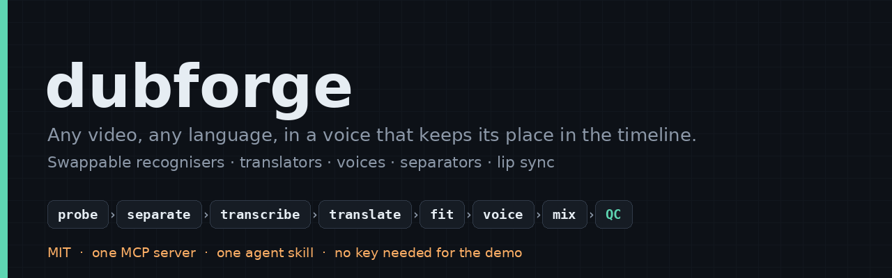

# dubforge

[](https://github.com/chaudharyvivek1/dubforge/actions/workflows/ci.yml)
[](https://github.com/chaudharyvivek1/dubforge/blob/main/tests)
[](https://github.com/chaudharyvivek1/dubforge/blob/main/pyproject.toml)
[](LICENSE)
[](src/dubforge/server.py)
[](#try-it-in-one-command)

**Dub any video into any language — with several AI providers in one pipeline that
is held to the clock.** One MCP server, one agent skill, swappable recognisers,
translators, voices, separators and lip sync, and a QC report that refuses to call
a bad dub finished.

Most "AI dubbing" is one API call: send the file, get a new audio track back, hope.
It falls over in the same three places every time — the translation is 30% too long
for the actor's mouth, the music disappears, and nobody can tell you whether the
output is usable without watching all of it. dubforge is built around those three.

```bash
pip install "dubforge @ git+https://github.com/chaudharyvivek1/dubforge.git"
dubforge demo
```

`dubforge demo` needs no API key, no GPU and no network. It builds a 9-second clip,
runs every stage for real, and writes an mp4 with a second audio track plus a QC
report — so you can see the machine work before you spend a rupee on it.

---

## Contents

[What it does](#what-it-actually-does) ·
[Install](#install) ·
[Dub something](#dub-something) ·
[From an agent](#use-it-from-an-agent) ·
[Jobs](#jobs-submit-watch-cancel-collect) ·
[Limits](#limits-capabilities-and-cost) ·
[Quality levers](#the-quality-levers-in-the-order-they-matter) ·
[Providers](#providers) ·
[Languages](#languages) ·
[Cost](#cost) ·
[School lab](#for-a-school-lab) ·
[Limits](#what-this-does-not-do) ·
[Repository layout](#repository-layout) ·
[Docs](#docs) ·
[FAQ](FAQ.md) ·
[Roadmap](ROADMAP.md) ·
[Credits](CREDITS.md) ·
[Contributing](#contributing)

## What it actually does

```
video ──► probe ──► separate stems ──► transcribe ──► translate ──► fit the clock
             │           │                  │             │              │
             │           │                  │             │        rewrite if too long
             │           │                  │             │              │
             │           └── music/effects  │      per-speaker voice ◄────┘
             │                   │          │              │
             └── picture (copied) │          │        synthesise per line
                                 │          │              │
                                 │          │        atempo to the window
                                 │          │              │
                                 └──────────┴──────► mix (ducked) ──► mux ──► QC
```

| Step | What prevents the failure |
|---|---|
| **Separate** | `demucs` or mid/side keeps the score, the laugh and the door slam; the dub sits *under* them, ducked |
| **Transcribe** | word-level timings from Deepgram / Scribe / Whisper, merged into sentences — never 30-second blocks |
| **Diarise** | one voice per speaker, chosen once and held for the whole film |
| **Translate** | one brief for every vendor: sayable, in character, names intact, glossary enforced |
| **Fit the clock** | every line is budgeted in characters before it is spoken; over-long lines go *back* to the translator |
| **Stretch** | only what is still slightly long, and never past `--max-speed` (1.15x by default) |
| **Mix** | loudness-normalised dub + original bed with sidechain ducking, then a stream copy of the picture |
| **QC** | twenty-three checks (twenty-four when the source has several audio tracks); a `fail` exits non-zero and says which line broke |

## Install

```bash
# straight from the repo, one line
pip install "dubforge @ git+https://github.com/chaudharyvivek1/dubforge.git"

# with the MCP server, and the free local engines
pip install "dubforge[mcp,local,sep] @ git+https://github.com/chaudharyvivek1/dubforge.git"

# development
git clone https://github.com/chaudharyvivek1/dubforge.git
cd dubforge && pip install -e ".[mcp,dev]"
```

`ffmpeg` is the only hard dependency, and you may already have it. If you do not,
`pip install imageio-ffmpeg` ships a static binary that dubforge will find on its
own. Check what this machine can actually do — never guess:

```bash
dubforge doctor        # ffmpeg + filters + encoders + packages + keys + which provider each stage would use
dubforge providers     # every adapter, ready or not, verified or not, with an honest quality note
```

`doctor` reports whether a key is set, never its value.

## Dub something

```bash
# 1. what will this cost, and can I run it at all?
dubforge plan lecture.mp4 --to hi

# 2. dub it
dubforge dub lecture.mp4 --to hi \
  --asr deepgram --translator openai --tts elevenlabs \
  --voice-pool <voice-id-1>,<voice-id-2> \
  --glossary "ISRO=इसरो,UPI=यूपीआई" \
  --context "a Class 10 physics lecture on magnetism"

# 3. read the verdict, not just the file
dubforge dub lecture.mp4 --to ta --json | jq '.qc.failures, .qc_summary'
```

Outputs land next to the input, and everything a reviewer needs lands in the work
directory:

```
lecture.hi.mp4            the dub (picture stream-copied, audio re-encoded)
dubforge-work/
  jobs/lecture-a1b2c3d4-9f2e/     one directory per *request* (<stem>-<pathhash>-<requesthash>),
                                  locked while in use, so a Hindi and a Tamil job for the
                                  same file never share a workspace
    manifest.json                 what this job is, and how far it got
    dub_norm.wav                  the dub alone, loudness-normalised
    transcript.dub.json           source + translation + timings + per-line speed
    lecture.source.srt            what was said
    lecture.hi.srt                what the dub says
    lecture.bilingual.srt         both, for proofreading
    lecture.vtt                   web subtitles
    qc.json                       the machine-checkable verdict
    report.md                     plan, steps, QC and file list in one page
  cache/<content-key>/transcript.json
                                  shared across jobs: the same file dubbed into two
                                  languages pays for recognition once
```

Two jobs on the same file get separate directories (`…-2`, `…-3`), and two files with
the same name in different folders never share one. An interrupted run resumes in its
own directory: `manifest.json` records which steps finished.

`--dry-run` stops after the plan. `--json` on any command gives machine output.

## Use it from an agent

```json
{
  "mcpServers": {
    "dubforge": {
      "command": "dubforge-mcp",
      "env": {
        "DEEPGRAM_API_KEY": "…",
        "OPENAI_API_KEY": "…",
        "ELEVENLABS_API_KEY": "…"
      }
    }
  }
}
```

`verified: false` on every network adapter is not a shrug: `scripts/verify_providers.py`
makes the smallest real request each vendor allows, records the date and API version in
`docs/verification.json`, and a test fails if an adapter claims `verified` without an `ok`
row there. Nothing is marked verified until someone has actually spent a rupee on it.

Twenty-seven tools, and the intended order is in the server's instructions:
`dubforge_doctor` → `plan_dub` → `dub_video` (or `dubforge_submit_job` for anything long)
→ read `qc`. Transcripts come back as
a path and a five-line preview, never as a wall of text.

There is also an agent skill in [`skill/SKILL.md`](skill/SKILL.md) — the workflow,
the failure modes, and the prompts that actually keep a translation inside its time
budget.

## Jobs: submit, watch, cancel, collect

A long dub should not be one blocking tool call. `dubforge 0.2.0` adds a job engine built
on the workspace that was already there — a JSON document per job, a bounded thread pool,
and no database:

```bash
dubforge dub lecture.mp4 --to hi            # still synchronous, still the same flags
dubforge batch lessons/ --to hi --estimate  # a folder, one job per file, failures isolated
dubforge jobs list                          # newest first, paginated
dubforge jobs show lecture-a1b2c3d4         # status, QC, where it got to
dubforge jobs cancel lecture-a1b2c3d4       # cooperative, checked between stages
dubforge jobs cleanup --older-than 30       # dry run unless you pass --yes
```

```
queued → validating → processing → quality_check → completed
                            ↘ failed   ↘ cancelled   ↘ interrupted
```

* **`interrupted` is a real state.** A job whose process died is reported as interrupted
  — never as completed — and `recover()` reconciles the registry on startup.
* **One job per request, not per file.** The id is `<stem>-<pathhash>-<requesthash>`, so the
  same video into Hindi and Tamil is two jobs that run side by side, the identical request
  twice is one job (`duplicate: true`), and a different voice or provider can never inherit
  another run's output.
* **One owner, one heartbeat.** A claim file (created with `O_EXCL`) gives exactly one worker
  the right to move a job, and the worker refreshes a heartbeat on a timer. Recovery trusts
  the pid where pids mean something, and the heartbeat where they do not — so a four-minute
  provider call is never mistaken for a dead process.
* **Cancellation is cooperative and honest about it:** checked between stages and before
  every paid call, so a line in flight finishes and ffmpeg is not killed mid-write.
* **`providers_used`** records what actually ran, separately from what you asked for —
  because with `--fallback` those are not always the same.
* **A retry can cost money.** A timeout on a synthesis is *not* retried: the vendor may have
  accepted and billed it. You get `kind: "ambiguous"` and a sentence saying so, instead of a
  silent second charge. Rate limits and server errors are retried; only OpenAI gets its
  documented `Idempotency-Key`, because inventing one would be a lie.

From an agent, the same thing over MCP: `dubforge_submit_job` → `dubforge_get_job_status`
→ `dubforge_get_job_result`, with `dubforge_cancel_job`, `dubforge_retry_job` and
`dubforge_list_jobs` alongside.

## Editing one line, not the film

```bash
dubforge jobs list                                  # find the job
dubforge regen lecture-a1b2c3d4 --set 3="यह संपादित पंक्ति है।"
```

Only line 3 is synthesised again. Every other line is reused from the job's segment store —
the **raw** render, keyed on text, voice, provider, model, language, style and sample rate,
with the audio's SHA-256 checked on reuse. The result goes to a new file
(`lecture.hi.r1.mp4`); the previous output is never replaced by a run that might fail.

Timing is deliberately *not* part of that key: the stretch depends on the window, which
changes when a neighbour changes, and re-running atempo costs milliseconds while re-running
TTS costs money.

## A review loop that costs one synthesis per edit

```bash
dubforge review export lecture-a1b2c3d4 --out review.json
# edit `edited_target_text` on the lines that need it
dubforge review validate review.json
dubforge review apply review.json          # → a new file, only edited lines synthesised
```

The file carries the job id and the source's content fingerprint, so a review of a different
version of the video is refused rather than applied to the wrong film. Unknown or duplicated
segments, non-string or oversized text, and any attempt to set paths, tokens or provider keys
are refused too. Applying the same file twice is a no-op. A static `review.html` is written
beside `review.json` — no server, no remote assets.

## What a re-run actually reuses

| stage | reused on a regeneration? |
|---|---|
| separated background bed | yes, when the source and separator match |
| transcription | yes |
| TTS renders of unchanged lines | yes, by fingerprint |
| decoded audio | **yes** — keyed on the source's content hash and the format |
| stretched render | **yes**, keyed on the render and the speed applied — one ffmpeg process per line saved |
| dialogue track | **spliced** — only the changed lines' own ranges are replaced, in one pass |
| normalisation, ducking, mix | **yes, if the dialogue's bytes did not change** — a splice rebuilds them, because the loudness gain is global |
| mux | **yes, if the mix, source and bitrate are unchanged** |

A run with nothing changed reuses every stage and writes a byte-identical file: on the
9-second demo, 6.2 s became 2.3 s. `review.json` reports `work.dialogue_mode`, `mix_mode`,
`mux_mode`, `rebuilt_stages` and per-stage seconds, so you can see exactly where a
regeneration spent its time.

`review.json` reports the real numbers (`work.reused_renders`, `work.rendered_segments`,
`work.stems_reused`, `work.cache_hit_ratio`, `work.dialogue_mode`, `work.spliced_lines`,
`work.rebuilt_stages`), because "5 lines regenerated" is not "5 lines of work". A splice is
refused when a changed line overlaps another, and the report says `assembled` when that
happens.

## Proving a provider actually works

Every network adapter ships `verified: false`, and the flag is *derived*: a test fails if an
adapter claims verification without an `ok` row in `docs/verification.json`.

```bash
dubforge verify plan            # what would run, which key, what it costs — no requests
dubforge verify run --yes-live  # the real thing; refuses without the flag
dubforge verify import rec.json # accept evidence produced on a machine that had keys
dubforge verify status          # what the ledger says now
```

The flag is derived, not declared: an `ok` row younger than 180 days verifies a network adapter,
an older row expires and says so, and a local adapter (the stub, the transcript reader, ffmpeg
centre-removal) is labelled as proven-by-the-suite rather than blended with a live check. A
declaration without evidence is reported as a contradiction.

A row that says `ok` means the credentials work and the response shape is right. It does not
mean the voice sounds good or the translation is accurate — that needs a human, which is what
`review.json` is for. The full procedure, and what a rejected import looks like, is in
[docs/verification.md](docs/verification.md).

## Asking what a run cost

```bash
dubforge explain lecture-a1b2c3d4          # or --json, or the MCP tool dubforge_explain_job
```

It reads the job's `review.json` and prints which stages were reused, which were rebuilt, where
the seconds went, the QC failures, and what one more edited line would cost. No guesses: a job
without a `review.json` gets the reason, not a table of zeroes.

## Alignment: measured, or absent

Word-level timings are stored only when a provider reports them, validated for ordering,
duration and containment, and rejected if they fail. There is no "estimate" state — nothing
distributes a sentence's duration across its words and calls it alignment — and a run without
measured timings says **sentence-level timing only** in its warnings and marks every row of
`review.json` accordingly.

## Limits, capabilities and cost

```bash
dubforge capabilities        # what this install can do, derived from the adapters
dubforge validate-config     # check a settings file without starting work
dubforge plan lecture.mp4 --to hi   # cost, providers, timing budget, blockers
```

Seven limits are refusals, not warnings — checked before the first paid call and again
between stages: `max_input_bytes` (4 GiB), `max_input_seconds` (4 h), `max_run_seconds`
(4 h), `max_estimated_usd` ($25), `max_concurrent_jobs` (2), `max_retries` (2),
`job_retention_days` (30). Set them in the environment (`DUBFORGE_MAX_ESTIMATED_USD=5`)
or in a settings file; each failure names the setting to change.

## The quality levers, in the order they matter

1. **Translation that fits.** `fit.py` estimates spoken seconds per language from
   characters per second, compares that to the window before the next line starts,
   and sends anything over budget back to the translator with an explicit character
   limit. Two rounds by default. This is the single biggest difference between a dub
   and a translation read out loud.
2. **Voice identity.** Diarisation from the recogniser, one voice mapped per
   speaker, held for the whole file. `--voice-map SPEAKER_00=<id>` when you know
   who is who.
3. **The bed.** Separating the original music and effects and ducking them under the
   dub is what stops the result sounding like a phone call from an empty room.
4. **Emotion and register.** `--style` and `--emotion` reach the vendors that
   support them (ElevenLabs voice settings, OpenAI `instructions`), and `--context`
   reaches the translator, which matters more than either.
5. **Pronunciation.** `--glossary` pins names, acronyms and regional terms so they
   are not silently translated into something else.

The full reasoning, including the arithmetic and the knobs, is in
[`docs/quality.md`](docs/quality.md).

## Providers

Every stage is swappable. `auto` picks by quality first, cost second, and it never
falls back to a stub — a dub that quietly did nothing is worse than an error that
names the missing key.

| Stage | Options | Free / local option |
|---|---|---|
| **Speech recognition** | `faster_whisper`, `deepgram`, `elevenlabs` (Scribe), `groq`, `openai`, `transcript` (reuse one) | `faster_whisper` |
| **Translation** | `openai`, `gemini`, `sarvam` (Mayura), `deepl`, `ollama`, `stub` | `ollama` |
| **Voice** | `elevenlabs`, `sarvam` (Bulbul), `openai`, `google`, `edge_tts`, `stub` | `edge_tts` |
| **Separation** | `demucs`, `ffmpeg_center`, `none` | both |
| **Lip sync** | `none` (default), `synclabs` | — |

`verified: false` in `dubforge providers` means the adapter is written against the
vendor's documentation and has not been exercised against the live API in this
release. That flag exists so nobody ships a paid batch on an unverified path. Only
the offline adapters and the ffmpeg paths are marked verified today.

Details, including each adapter's gotchas: [`docs/providers.md`](docs/providers.md).

## Languages

Indian languages first, because that is the hard case and the reason this exists:
Hindi, Bengali, Tamil, Telugu, Marathi, Gujarati, Kannada, Malayalam, Punjabi, Odia,
Assamese and Urdu, plus English and the usual European set. `fit.py` carries a
speech-rate constant per language, so a Tamil line is not budgeted like an English
one. Coverage per provider, script handling, numbers and RTL: 
[`docs/languages.md`](docs/languages.md).

## Cost

`dubforge plan` estimates it before you spend anything, from list prices with the
source for each row in [`docs/cost.md`](docs/cost.md). A rough shape for a 10-minute
video, using list prices checked in November 2026: about $0.05 for recognition on
Groq, a few cents for translation, and then the voice decides everything — roughly
$1–4 on ElevenLabs, or $0 on `edge_tts`. End-to-end dubbing APIs charge $0.50–$2.20
per *minute* for comparison.

## For a school lab

The whole thing runs offline on a laptop: `faster_whisper` for recognition,
`ollama` for translation, `edge_tts` for voices, `ffmpeg_center` for the bed. No
account, no upload, nothing leaves the machine. Batch a folder, keep a consent log,
and check the QC of every file before it goes near a student:
[`docs/school.md`](docs/school.md).

## What this does not do

* **It is not a translation service.** It orchestrates ones you have keys for.
* **The demo is a tone, not a voice.** QC marks the stub translation as a failure on
  purpose, so a pipeline test can never be mistaken for a finished dub.
* **Lip sync is off by default and needs public URLs.** Reshaping mouths on real
  people is a consent question before it is a technical one.
* **It will not tell you a dub is good.** It will tell you it fits the clock, has one
  voice per speaker, keeps the bed, and does not clip. Whether it *sounds* right is
  still your ears, and the bilingual SRT is how you check the words fast.
* **Cloning a real person's voice needs that person's written permission.** See
  [`docs/security.md`](docs/security.md).

## Docs

Three of these are **generated from the code** (`python scripts/gen_reference.py`), and CI
fails if they drift — a setting, tool or flag cannot be added without being documented.
Start with the FAQ if you have a "why does it sound like this" question; start with
`quality.md` if you are tuning a real deliverable.

| Document | What is in it |
|---|---|
| [FAQ.md](FAQ.md) | 22 real questions: no keys, rushed lines, one voice, music gone, cloning, cost |
| [docs/architecture.md](docs/architecture.md) | every stage, the data model, files on disk, how to add a provider, the design rules |
| [docs/providers.md](docs/providers.md) | all 24 adapters: env vars, capabilities, honest quality notes, gotchas, and how to write one |
| [docs/quality.md](docs/quality.md) | the timing arithmetic, the QC checks, and a symptom → fix table |
| [docs/qc-inventory.md](docs/qc-inventory.md) | the authoritative check list, generated from `qc.py` (names, severities, when each runs) |
| [docs/languages.md](docs/languages.md) | Indic coverage per stage, script/number/formality/gender traps, RTL |
| [docs/cost.md](docs/cost.md) | list prices with sources, worked examples, how to cut the bill |
| [docs/school.md](docs/school.md) | classroom deployment, consent, batch runs, offline mode, a first-week plan |
| [docs/platforms.md](docs/platforms.md) | Linux, macOS, Windows, Docker, CPU-only sandboxes, hardware guidance |
| [docs/security.md](docs/security.md) | keys, consent, student footage, what leaves the machine, hostile transcripts |
| [skill/SKILL.md](skill/SKILL.md) | the agent skill: workflow, provider choice, failure modes, review loop |
| [docs/assessment.md](docs/assessment.md) | architecture, feature and gap inventory, dependency/licence and security assessment, phased roadmap |
| [ROADMAP.md](ROADMAP.md) | what is next, and what is explicitly not planned |
| [CREDITS.md](CREDITS.md) | every project and vendor this stands on, with licences |
| [CHANGELOG.md](CHANGELOG.md) | what changed, and the known limitations of each release |
| [docs/configuration.md](docs/configuration.md) | **every setting**: environment name, type, default, range (generated) |
| [docs/mcp-tools.md](docs/mcp-tools.md) | **every MCP tool**: parameters, types, defaults, envelope (generated) |
| [docs/cli.md](docs/cli.md) | **every CLI command and flag** (generated) |
| [docs/verification.md](docs/verification.md) | the live-verification procedure, how the flag is derived, what a green row does not mean |
| [docs/release-0.9.2.md](docs/release-0.9.2.md) | the 0.9.2 checklist: the QC inventory, docs coverage, the verification record |
| [docs/release-0.9.1.md](docs/release-0.9.1.md) | the 0.9.1 checklist: polling deadlines, error classification, registry atomicity |
| [docs/release-0.9.0.md](docs/release-0.9.0.md) | the 0.9.0 checklist: expiry, local vs network, contradictions |
| [docs/release-0.8.0.md](docs/release-0.8.0.md) | the 0.8.0 checklist: the verification ledger, plan/run/import |
| [docs/release-0.7.0.md](docs/release-0.7.0.md) | the 0.7.0 checklist: the cost model, extraction and placement caches |
| [docs/release-0.6.0.md](docs/release-0.6.0.md) | the 0.6.0 checklist: stage reuse, where it stops, timing |
| [docs/release-0.5.0.md](docs/release-0.5.0.md) | the 0.5.0 checklist: partial remixing, splice safety |
| [docs/release-0.4.0.md](docs/release-0.4.0.md) | the 0.4.0 checklist: identity, concurrency, stem cache, review loop |
| [docs/release-0.3.0.md](docs/release-0.3.0.md) | the 0.3.0 checklist: audit, timing rules, alignment, regeneration |
| [docs/calibration.md](docs/calibration.md) | measured speech rate per language, or an honest estimate |
| [docs/release-0.2.1.md](docs/release-0.2.1.md) | the 0.2.1 reliability checklist: bugs, fixes, tests, risks |
| `scripts/benchmark.py` | measure the engine on three media sizes, and a full run against 0/1/5/10% edits (`--regen`) |
| [docs/release-0.2.0.md](docs/release-0.2.0.md) | the 0.2.0 checklist: job engine, scope, compatibility |

## Repository layout

```
src/dubforge/
  pipeline.py      the orchestrator: plan() and dub(), the eleven steps in order
  ffmpeg.py        every decode, filter, mix, mux and measurement; ffmpeg resolution
  fit.py           the timing model — chars/second per language, verdicts, budgets
  timeline.py      words → sentences → speaker labels → per-line windows → voices
  media.py         Word / Segment / Transcript, JSON round-trip, cache fingerprint
  qc.py            the twenty-three checks, the metrics, the one-screen summary
  srt.py           source / target / bilingual SRT and WebVTT
  config.py        Settings: flags, JSON file, environment; never prints a secret
  doctor.py        what this machine can and cannot do, with the fix for each gap
  demo.py          the offline clip, the offline run
  cli.py           doctor · providers · voices · plan · dub · demo · srt · mcp
  server.py        the MCP server (10 tools), validation and structured errors
  workspace.py     job directories, locks, the shared transcript cache, safe cleanup
  jobs.py          job documents, lifecycle, recovery, the background runner
  capabilities.py  what this install can do, derived from the adapters
  limits.py        resource and cost refusals, checked before anything is spent
  batch.py         a folder of files through the same pipeline
  pricing.py       indicative list prices, with sources, for `plan`
  providers/       one module per stage + registry.py (what exists, what `auto` picks)
tests/             56 tests; the ffmpeg ones skip themselves when ffmpeg is absent
docs/              8 documents, one per question a user actually asks
skill/             SKILL.md + 4 references, for agents
examples/          classroom batch, one-shot shell, library use
```

## Credits

dubforge is a pipeline, not an engine: FFmpeg does the audio, and the recognition,
translation, voices and separation come from other people's work. [CREDITS.md](CREDITS.md)
names every one of them with its licence — including the ones this project would not
exist without, like [faster-whisper](https://github.com/SYSTRAN/faster-whisper),
[Demucs](https://github.com/adefossez/demucs) and [edge-tts](https://github.com/rany2/edge-tts).

If you cite this in teaching material, [CITATION.cff](CITATION.cff) is machine-readable.

## Contributing

Bug reports with a failing QC report attached are the most useful thing you can send —
`qc.json` and `report.md` contain no keys. A new provider is one file and one registry
line. The most valuable contribution right now is verifying one network adapter against
a live key and flipping its `verified` flag.

* [CONTRIBUTING.md](CONTRIBUTING.md) — setup, the provider contract, what gets pushed back on
* [CODE_OF_CONDUCT.md](CODE_OF_CONDUCT.md) — short, and enforced
* [SECURITY.md](SECURITY.md) — how to report a vulnerability privately
* [.github/ISSUE_TEMPLATE](.github/ISSUE_TEMPLATE) — the forms ask for the QC report, on purpose

## Licence and terms

Code: **MIT** — see [LICENSE](LICENSE). Copyright © 2026 Vivek Chaudhary.

What that does *not* cover: the vendors' APIs, their models and their voices, each
governed by their own terms — including their rules on voice cloning, consent and
acceptable use. Prices quoted in the docs are indicative list prices read in November
2026, not quotes. See [CREDITS.md](CREDITS.md) for the full list of dependencies and
their licences.
